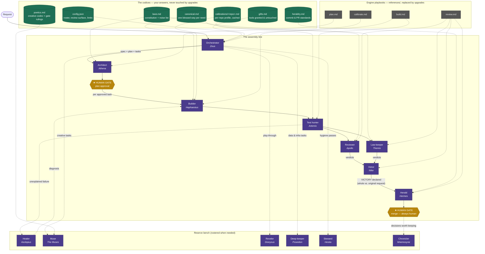

# Gaia

A Claude Code plugin that forges bespoke AI factories. Run `/gaia` once,
answer an interview, and she raises a custom **temple** — a pantheon of
specialized agents, laws, and workflows tuned to your account's tools,
standards, and goals.

One account can hold many temples, each shaped by its own answers: which
decisions pause for a human, which gods are rostered, which laws bind. A
temple can be strict about security and relaxed about prose, the reverse, or
exacting about both — the interview sets the dials; nothing is preordained.

See [SPECIFICATION.md](SPECIFICATION.md) for the full design.


## How Gaia works

Gaia is a *factory builder*, not a factory. Installing the plugin gives you
one skill, `/gaia`, which forges temples in three phases:

1. **The terrain survey.** Gaia inspects the account before asking anything:
   MCP servers, plugins, skills, agents, CLIs on PATH. Everything found
   becomes a *divine gift* candidate — a tool the temple's gods may wield.
   Sparse account? Gaia switches from surveyor to **guide**, looking up
   current best-in-class tools per category (live, from the MCP registries —
   never from stale memory) and offering to help set them up. A temple with
   few gifts is still a working temple.

2. **The interview.** Nine steps, one topic at a time: name & purpose,
   pantheon, gifts, laws, canon & roster, heraldry, review surface, cost
   tiers, and poetics (when a Muse is rostered). Every answer is drafted into
   the exact text that will land in the temple's files, shown for revision,
   and saved — you can pause after any step and resume later. Gaia never
   invents an answer you didn't give; an open question becomes a dated "not
   yet ruled" marker, not silent best practice.

3. **The forging.** The template renders into a preview directory for your
   inspection. Only on your explicit yes does anything land in `~/.claude/` —
   agents, the temple's entry skill, and its codices. Collisions stop the
   forge; nothing is ever overwritten silently.

The forged temple then answers to `/<temple>` in any repository the account
opens. On first use in a repo it **calibrates** — a read-only survey of that
repo's build commands, test runner, and conventions, cached as a profile the
gods are briefed with. Temples also carry a **temple editor** back in
`/gaia`: roster a god later, retire one, amend a codex, re-skin to a new
pantheon, or upgrade the engine when the plugin updates — all without
touching your laws.

## The pantheon

Roles are fixed; gods are skins. A temple staffs some or all of fourteen
fixed roles, and the pantheon you choose (Greek, Roman, Norse, Hindu, or your
own table) only decides their names. The **core seven** run the assembly
line:

| Role | Greek default | Duty |
|---|---|---|
| **Orchestrator** | Zeus | The main session. Decomposes, dispatches, enforces limits. Writes no production code. |
| **Architect** | Athena | Turns a request into spec + plan + tasks, with a mandatory test strategy. |
| **Builder** | Hephaestus | Implements one approved task at a time, on an isolated branch. |
| **Test hunter** | Artemis | Writes and runs tests; hunts edge cases and regressions. |
| **Reviewer** | Apollo | Independent, read-only review of the finished diff. |
| **Law-keeper** | Themis | Enforces the temple's laws: standards, canon, security, conventions. |
| **Herald** | Hermes | Commit messages, PR descriptions, changelogs — in the temple's registered style. |

The **reserve bench** is rostered when the temple's purpose calls for it:

| Role | Greek default | Duty |
|---|---|---|
| **Chronicler** | Mnemosyne | Decision log — records why choices were made. |
| **Steward** | Hestia | Housekeeping — dependencies, dead code, hygiene. |
| **Deep-keeper** | Poseidon | Data & infrastructure — databases, migrations, environments. |
| **Healer** | Asclepius | Debugger — root-causes failures the Test hunter can't explain. |
| **Victor** | Nike | Certifies the assembled whole against the original request before the Herald may draft its PR. |
| **Muse** | The Muses | Creative generation — narrative, design, game content. |
| **Reveler** | Dionysus | Playtester — experiences the product as a user would. |

Three **iron rules** bind every temple regardless of its answers: humans hold
the merge gate, writers write alone (one writing god per set of files, and
reviewers are read-only), and every god's brief must stand alone — dispatched
gods never see the Orchestrator's conversation, so everything a god needs
rides in its brief.

## How the gods work together

A request enters at the Orchestrator and moves down the assembly line. Each
stage has a playbook in the temple's `references/`, and each god is briefed
from the codices in its remit — the `.md` files holding *your* answers, which
no engine upgrade ever touches.



Reading the diagram: solid arrows are the assembly line; dashed arrows are
either reserve-bench dispatches (which exist only when that god is rostered)
or a file riding into a god's brief. The Victor is drawn on the line because
of a deliberate coupling: **the Herald may not draft a PR until the Victor
has declared VICTORY** on the assembled whole against the original request
(or the human has waived it). Without a Victor rostered, the Orchestrator
runs its own labeled checklist at that spot instead — the gate remains, only
the god changes.

Every god also has a standing remit file of its own — its agent definition in
`~/.claude/agents/<temple>-<god>.md`, with its mandate, its musts and
must-nots, and the shape of what it returns. Those are engine files: an
upgrade or a roster change re-forges them; your codices it never touches.

## What lands where

A forged temple is a handful of files with three distinct classes:

| Class | Files | Ownership |
|---|---|---|
| **Engine** | `skills/<temple>/SKILL.md`, `references/*`, `agents/<temple>-*.md` | Gaia's — replaced wholesale by upgrades and roster changes |
| **User data** | `laws.md`, `canonical.md`, `gifts.md`, `heraldry.md`, `poetics.md`, `config.json` | Yours — written only through interview flows, never by an upgrade |
| **Cached** | `calibrations/` | Disposable — rebuilt on demand |

Two invariants make upgrades safe to offer freely: no interview answer is
ever written into an engine file, and no engine content into a user-data
file.

## Repository layout

```
.claude-plugin/        plugin + marketplace manifests
skills/gaia/
  SKILL.md             the generator: routing, phases, hard rules
  references/          survey.md, interview.md, forge.md, editor.md
  scripts/             check_name.py (temple-name collision check)
  assets/
    pantheons.json     role → deity tables (Greek, Roman, Norse, Hindu)
    template/          the parameterized temple Gaia forges from
SPECIFICATION.md       the full design, with the settled-questions log
```
